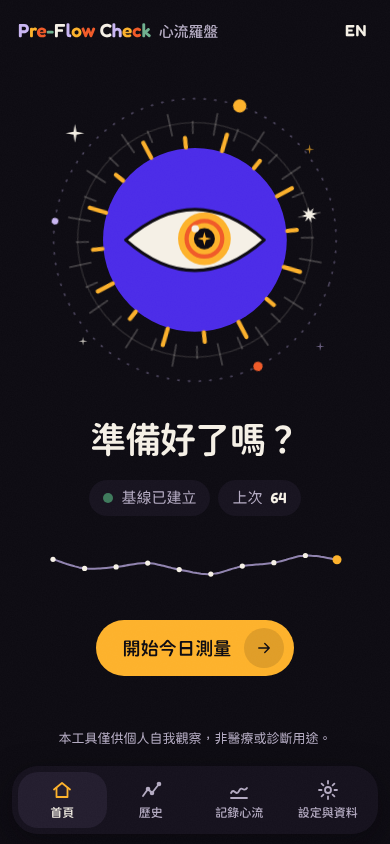
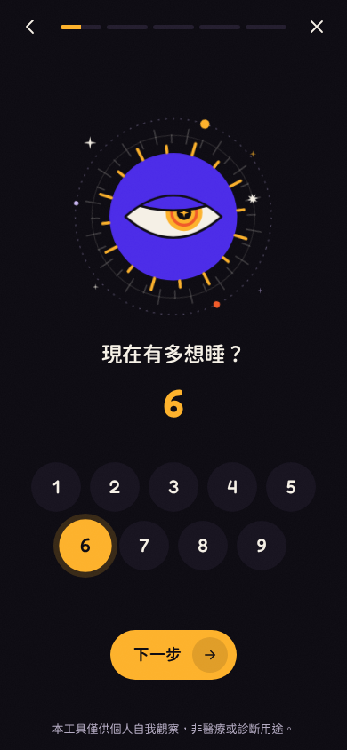
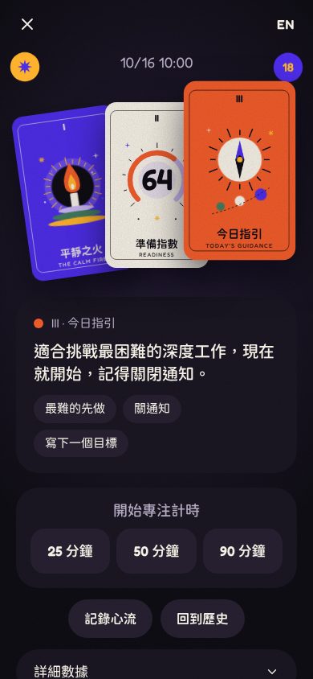
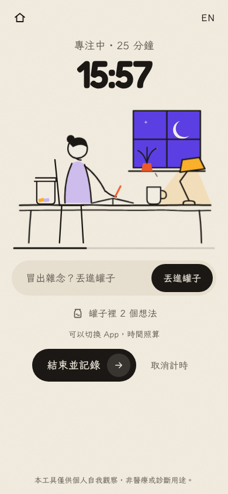
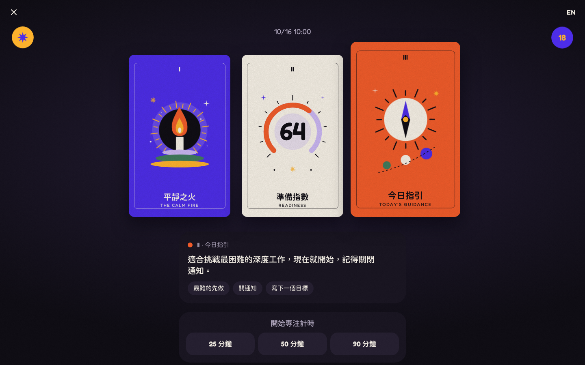

# Pre-Flow Check · 心流羅盤

**A 4-minute pre-work check that estimates your mental readiness for focus and flow — then learns, from your own flow logs, what actually predicts it.**

**Live demo:** https://remmin0.github.io/pre-flow-check/

<p>
  
  
  
  
</p>


UI in Traditional Chinese (default) and English — switch with the button in the top-right corner.

## What it does

1. **Intro (first launch)** — three short screens: what it is, how it works, what you get.
2. **Three feelings, one per screen** — sleepiness (KSS 1–9), energy and tension (1–10). Each has a big living picture that reacts as you tap: an eye that grows sleepy, a flame that grows, a ring that trembles with tension. Picking a number moves you on.
3. **Today so far (optional)** — sleep, what you're about to do; wake time, caffeine and wearable numbers tucked under “More”.
4. **Reflex test (3 min)** — the brief Psychomotor Vigilance Test (PVT-B): tap or press Space whenever the yellow dot appears.
5. **The card table** — three cards are dealt onto the table; turn them over one by one to read your *state archetype*, your *Readiness Index* (0–100 against your own baseline) and *today's guidance*. The cards come alive once turned: eyes blink and look around, the flame flickers, the lake ripples, the gauge fills.
6. **Focus mode (optional)** — a 25 / 50 / 90-minute timer in a calm paper-and-ink scene. Stray thoughts go into the **idea jar**: type one, and it flies into the jar as a paper slip so you can get back to work.
7. **After work** — log how much flow you felt (1–10) along with the jar's ideas. After ten logs, *Insights* shows which factors move with your flow.

## Design

Two worlds share one motion system:

- **The tarot table** (home, the guided check, the card reveal, history, settings): deep tinted night with flat, saturated colour — indigo, mustard, orange-red, forest green, lavender, cream — and original geometric illustrations whose eyes, flames and ripples move.
- **The paper journal** (focus mode, flow log): warm paper with ink line drawings that draw themselves on.

Motion uses transform/opacity only with custom easing curves, view transitions between screens (slide between questions, a circular reveal into the card table) and respects `prefers-reduced-motion`. Copy is kept to a few words per screen. All artwork is original SVG drawn in code; the visual direction was inspired by, not copied from, the reference images in the brief. Design skills used during the redesign live in `.claude/skills/`.

## Why

Most tools do one half of the job: they either measure alertness (a reaction-time test, a sleepiness scale) or ask you to log focus/flow afterwards. Pre-Flow Check does both and connects them — it **predicts before work** and **validates after work** — so over time you learn which factors (sleep, energy, reaction speed, time of day…) predict *your* flow, rather than relying on population averages.

## How it works

### Measures

| Measure | What | Source |
|---|---|---|
| KSS | 1–9 subjective sleepiness | Åkerstedt & Gillberg (1990) |
| Energy / tension | Two independent 1–10 self-ratings | Thayer's energy–tension model (1989) |
| PVT-B | 3-min reaction test: ISI 2–5 s uniform, lapse = RT ≥ 355 ms, false start = response before the stimulus or RT < 100 ms, 30 s no-response = lapse | Basner, Mollicone & Dinges (2011) |

From the PVT the app computes median RT, **mean response speed** (mean of 1000/RT, in 1/s), mean of the fastest and slowest 10%, lapses and false starts. Timing uses `performance.now()`/event timestamps; stimulus onset is the first animation frame after the stimulus is painted; touch input uses `pointerdown`; the screen is kept awake with the Wake Lock API where available; switching tabs/apps invalidates the run and offers a retest. Because touchscreens, keyboards and mice have very different latencies, **PVT baselines are kept separately per input device**.

### Scoring

All scoring lives in pure, unit-tested functions (`js/scoring.js`) with every constant in one config object (`js/config.js`).

- **Personal baseline:** mean and SD of your most recent 14 valid sessions (enabled at 5). PVT metrics use the same input device only; self-ratings and context are pooled across devices. Each metric has an SD floor so a very consistent history doesn't explode z-scores.
- **z-scores**, oriented so higher = better and clamped to ±3:

  | Metric | Weight |
  |---|---|
  | PVT mean response speed | 0.35 |
  | PVT lapses (inverted) | 0.20 |
  | KSS (inverted) | 0.20 |
  | Energy | 0.15 |
  | Sleep hours / HRV / device readiness | 0.10 combined, only when provided (missing weight is redistributed proportionally) |

- **Readiness Index = clamp(50 + 15 × weighted mean z, 0, 100)** — 50 means "like your usual self".
- With fewer than 5 baseline sessions, a **provisional** index is computed from KSS and energy only and labelled 「暫定，基線建立中」.
- **Tension is not in the index**; it drives the archetype and the recommendation.

### The four archetypes (Thayer's energy × tension)

High/low is judged against your own mean (or a threshold of 6 while data is scarce).

| | Low tension | High tension |
|---|---|---|
| **High energy** | 平靜之火 The Calm Fire — best for flow | 風暴 The Storm — powerful but distractible |
| **Low energy** | 靜湖 The Still Lake — relaxed but sluggish | 迷霧 The Fog — tired and irritable |

### Recommendation rules (first match wins; editable in `js/config.js`)

1. Index < 40, or lapses clearly above your baseline → mechanical tasks, or a 10–20 min nap, a walk, water first.
2. Index ≥ 60 and tension ≤ 5 → tackle your hardest deep work now; silence notifications.
3. Index ≥ 60 and tension > 5 → 2 minutes of slow breathing first (inhale 4 s, exhale 6 s), with a built-in breathing animation.
4. Index 40–59 → medium-difficulty tasks in 25-minute pomodoros.

Between 13:00 and 15:00 a note explains that a post-lunch dip is normal.

### Insights

After ≥ 10 sessions with a flow log, Spearman rank correlations between each factor (KSS, energy, tension, PVT speed, lapses, sleep, HRV, time of day, and the index itself) and your flow rating are shown in plain language with the sample size — and a reminder that correlation is not causation. A time-of-day view shows when your index is usually highest.

## Privacy

There is no server and no account. **All data stays in your browser's `localStorage` and is never sent anywhere.** Settings & data lets you export a JSON backup (and re-import it, e.g. on a new phone), export CSV for spreadsheets, or clear everything (double confirmation). If browser storage is unavailable (e.g. some private modes) the app still runs and warns you that nothing will be saved.

## Run locally & deploy

No build step. Either open `index.html` directly, or serve the folder statically (needed for the service worker / offline mode):

```sh
npx http-server -c-1 .        # or: python3 -m http.server
```

Tests:

```sh
node --test tests/unit/*.test.js     # scoring, baseline, correlation, storage
node tests/e2e/run.js                # Playwright: every screen at 390×844 and 1440×900 in both
                                     # languages (no horizontal scroll, ≥44px tap targets), the full
                                     # guided flow with automated PVT taps, card reveal, idea jar,
                                     # export → clear → import round trip, keyboard-only pass
```

**GitHub Pages:** in the repository go to *Settings → Pages*, choose *Deploy from a branch*, branch `main`, folder `/ (root)`, and save. The site appears at `https://<user>.github.io/pre-flow-check/` a minute later. All paths are relative, so it works under a sub-path. To install it, open the site on your phone and use *Add to Home Screen* (iOS Safari: Share → Add to Home Screen; Android Chrome: ⋮ → Install app).

When you change any file, bump `VERSION` in `sw.js` so installed copies pick up the update.

## Related work

- **[PersonalPVT](https://github.com/luketurner/PersonalPVT)** by Luke Turner — a browser-based PVT with results saved in the browser, trend tracking and CSV export.
- **Basner, M., Mollicone, D., & Dinges, D. F. (2011).** Validity and sensitivity of a brief psychomotor vigilance test (PVT-B) to total and partial sleep deprivation. *Acta Astronautica, 69*(11–12), 949–959. [doi:10.1016/j.actaastro.2011.07.015](https://doi.org/10.1016/j.actaastro.2011.07.015)
- **Åkerstedt, T., & Gillberg, M. (1990).** Subjective and objective sleepiness in the active individual. *International Journal of Neuroscience, 52*(1–2), 29–37. [doi:10.3109/00207459008994241](https://doi.org/10.3109/00207459008994241)
- **Thayer, R. E. (1989).** *The Biopsychology of Mood and Arousal.* New York: Oxford University Press. — the energy–tension model of mood and arousal.
- **Rheinberg, F., Vollmeyer, R., & Engeser, S. (2003).** Die Erfassung des Flow-Erlebens [The assessment of flow experience]. In J. Stiensmeier-Pelster & F. Rheinberg (Eds.), *Diagnostik von Motivation und Selbstkonzept* (Tests und Trends, N.F. Band 2). Göttingen: Hogrefe. — the Flow Short Scale (Flow-Kurzskala).

**How this project differs:** PersonalPVT and research PVT tools measure vigilance; flow questionnaires such as the Flow Short Scale measure the experience afterwards. Pre-Flow Check combines a **pre-work prediction** (sleepiness, energy/tension and PVT-B against your own baseline) with **post-work flow validation**, adds Thayer's **energy/tension axis** to tell calm readiness from tense arousal, and is a **free, open, no-account web app** that works offline on your phone.

## Disclaimer

本工具僅供個人自我觀察，非醫療或診斷用途。
For personal self-observation only — not a medical or diagnostic tool. Browser timing is less precise than research-grade PVT hardware: compare results with yourself, not with published norms.

## License

[MIT](LICENSE) © 2026 Remmin
